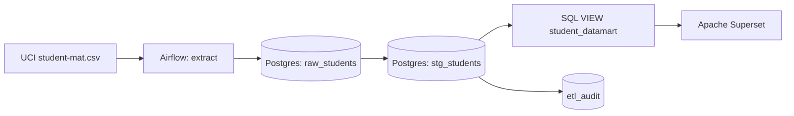
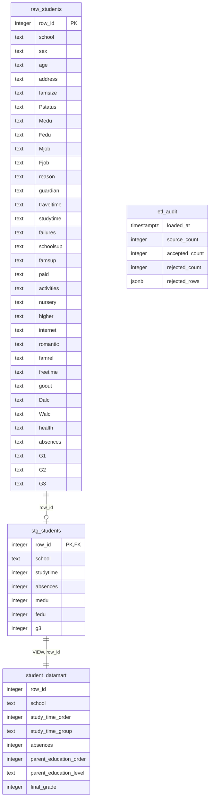
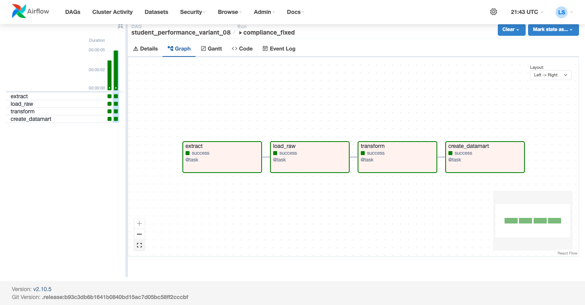
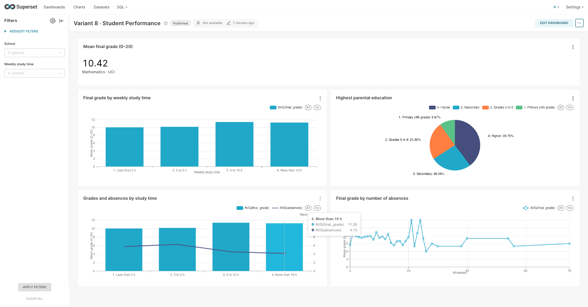
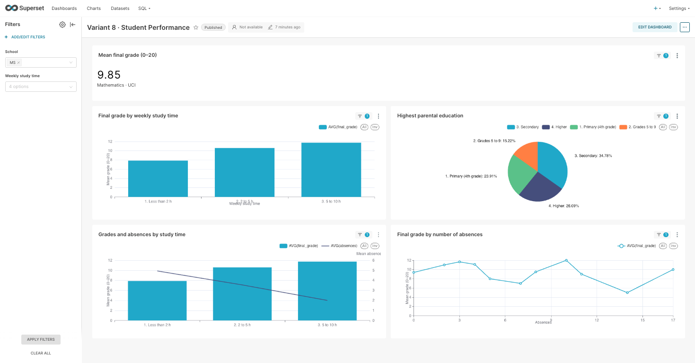

# Лабораторная работа 3 — вариант 8
## Анализ успеваемости студентов

**Состояние:** развёрнуто и проверено в Ubuntu 20.04.4 LTS ARM64 на Apple M4. DAG завершился успешно; дашборд содержит пять графиков и два интерактивных фильтра. Публикация репозитория выполняется отдельно.

## Цель работы
Определить, как итоговые оценки по математике связаны с временем самостоятельной учёбы, пропусками и образованием родителей. Результат помогает выбрать направления дополнительной учебной поддержки на уровне групп, без автоматических решений об отдельных учащихся.

## Источник и единица наблюдения
[Student Performance, UCI](https://archive.ics.uci.edu/dataset/320/student+performance), Paulo Cortez (2008), DOI: 10.24432/C5TG7T, лицензия CC BY 4.0.
Используется только `student-mat.csv`: одна строка — учащийся на курсе математики. Файл португальского языка не объединяется с ним, чтобы не удваивать учащихся, присутствующих в обоих наборах. Kaggle и его токен для данного варианта не нужны: индивидуальное задание указывает UCI.

## Метрики и правила расчёта
| Показатель | Поля и формула | Аналитический вопрос |
|---|---|---|
| Средняя итоговая оценка | AVG(G3), шкала 0–20 | Какова общая успеваемость? |
| Оценка по времени учёбы | AVG(G3) по studytime | Какие группы нуждаются в дополнительном изучении? |
| Доли по образованию родителей | COUNT(*) / общее COUNT(*) по GREATEST(Medu,Fedu) | Какова структура выборки? |
| Оценка и пропуски | AVG(G3), AVG(absences) по studytime | Как соотносятся показатели в группах? |
| Оценка по пропускам | AVG(G3) по точному absences | Как меняется средняя оценка при разном числе пропусков? |

`studytime`: 1 — менее 2 ч/неделю; 2 — 2–5 ч; 3 — 5–10 ч; 4 — более 10 ч. Категории сохраняют кодировку UCI; непрерывные часы из них не восстанавливаются.

`parent_education_level` — максимальный из Medu и Fedu: 0 — нет образования, 1 — начальное (4 класса), 2 — 5–9 классы, 3 — среднее, 4 — высшее. Это уровень наиболее образованного родителя, а не среднее образование семьи.

Нулевые оценки сохраняются. Пропуски значений не заменяются нулями. Проверяются допустимые диапазоны; все отклонённые строки с номером и причиной записываются в `etl_audit`. Точные совпадения строк автоматически не удаляются: идентификатора ученика в источнике нет.

## Архитектура решения
Среда: macOS на Apple M4 → VirtualBox → Ubuntu 20.04.4 LTS ARM64 → Docker Compose.



Две отдельные БД PostgreSQL: `postgres` хранит метаданные Airflow и Superset в разных базах; `analytics_postgres` хранит исследуемые данные. Состав контейнеров:

| Сервис | Роль |
|---|---|
| environment-init | Однократная подготовка ключей и прав на рабочий том |
| postgres | Метаданные Airflow и Superset в отдельных базах |
| analytics_postgres | Исходные RAW, очищенные STG, VIEW и журнал качества |
| airflow-init | Миграции Airflow, создание администратора и подключения |
| webserver | Веб-интерфейс Airflow |
| scheduler | Планирование и выполнение задач DAG через LocalExecutor |
| redis | Кэш Superset |
| superset-init | Миграции, роли и администратор Superset |
| superset | Дашборд и визуализации |
| pgadmin | Администрирование PostgreSQL |

Контейнеры `*-init` после успешного выполнения завершаются с кодом 0; остальные сервисы продолжают работать. Superset подключён к VIEW, а не к STG.

## Технологический стек
- Ubuntu 20.04.4 LTS ARM64, VirtualBox 7.2.12.
- Docker Engine 26.1.3 и Compose v2.27.1 из репозитория Ubuntu.
- Apache Airflow 2.10.5 / Python 3.11.
- PostgreSQL 12.22; Apache Superset 4.1.2; Redis 7.4.2; pgAdmin 9.1.
- apache-airflow-providers-postgres 6.0.0; psycopg2-binary 2.9.10; стандартные библиотеки Python для CSV, ZIP и HTTPS.

Версии приложений отличаются от старого примера README; архитектура задания сохраняется. Все контейнеры должны работать на ARM64 без эмуляции x86.

## ER-диаграмма

RAW содержит **все 33 исходных поля текстом** и технический ключ `row_id`; на диаграмме перечислены все поля. Связь STG → VIEW логическая: VIEW не хранит отдельную копию данных. `etl_audit` — журнал выполнения, не справочник студентов.

## Исходный код
- [DAG](dags/student_dag.py)
- [SQL-витрина](dags/datamart_variant_08.sql)
- [Docker Compose](docker-compose.yml)
- [Создание дашборда](superset/bootstrap_dashboard.py)

## Запуск
```bash
sudo docker compose up -d
sudo docker compose ps
```
`environment-init` автоматически создаёт случайные ключи в постоянном Docker-томе `lab_keys` и подготавливает права на том `pipeline_data`. Создавать `.env` и менять права вручную перед первым запуском не требуется. `setup.sh` — необязательная оболочка той же команды. Для обновления образа после изменения Dockerfile используйте `sudo docker compose up -d --build`. Для учебных интерфейсов используется admin/admin. Доступ к Ubuntu с Mac настроен только через локальные адреса 127.0.0.1.

Airflow: http://localhost:8080, Superset: http://localhost:8088, pgAdmin: http://localhost:5050 (admin@admin.com / admin).

Подключение `analytics_postgres` автоматически записывается в метаданные Airflow и доступно в Admin → Connections. Параметры: тип Postgres, host `analytics_postgres`, port `5432`, database/schema `analytics`, login/password `analytics`. DAG использует именно это подключение через `PostgresHook`, без отдельной строки DSN. В `load_raw` выполняется `PostgresHook.test_connection()`; при отрицательном результате задача завершается ошибкой, при успехе результат записывается в лог. Кнопка Test в интерфейсе включена настройкой `AIRFLOW__CORE__TEST_CONNECTION=Enabled`.

В Airflow включить и запустить `student_performance_variant_08`, дождаться успешного выполнения четырёх задач. Затем:
```bash
sudo docker compose exec -T superset python /app/lab/bootstrap_dashboard.py
```
Дашборд: `/superset/dashboard/student-performance-08/`. Фильтры по школе и времени учёбы применяются ко всем пяти графикам.

## Проверка результатов и материалы отчёта
Проверка выполнена в работающих сервисах: RAW = 395, STG = 395, VIEW = 395, отклонено = 0. DAG после исправлений: `compliance_fixed` (2026-11-04 21:41:43 UTC), итоговый статус `success`, все четыре задачи успешны.

Средняя итоговая оценка в PostgreSQL — 10,4151898734; среднее число пропусков — 5,7088607595. При фильтре `School = MS` остаются 46 записей, средняя оценка — 9,847826087 (на индикаторе 9,85); для GP — 349 записей и 10,48997135. На всех пяти графиках проверено применение фильтра MS.







[Полноразмерное изображение графиков](screenshots/dashboard.jpg) · [Графики для MS](screenshots/dashboard_filtered.jpg)

[Штатный экспорт Superset](superset/dashboard_export.zip) содержит дашборд, пять чартов, датасет и подключение. В Superset 4.1.2 стандартный формат экспорта — ZIP с YAML; его можно импортировать через Dashboards → Import. [JSON-представление экспортированных настроек](superset/dashboard_export.json) приложено отдельно. Для переноса можно использовать готовый ZIP либо восстановить его из JSON:

```bash
python3 superset/json_to_zip.py superset/dashboard_export.json /tmp/dashboard_from_json.zip
```

Полученный ZIP импортируется штатно через Dashboards → Import. Восстановление сохраняет все девять объектов экспорта: метаданные, подключение, датасет, пять чартов и дашборд. Скрипт [json_to_zip.py](superset/json_to_zip.py) не требует дополнительных библиотек.

## SQL создания витрины

```sql
CREATE OR REPLACE VIEW student_datamart AS
SELECT row_id, school,
 studytime AS study_time_order,
 CASE studytime WHEN 1 THEN '1. Less than 2 h' WHEN 2 THEN '2. 2 to 5 h'
 WHEN 3 THEN '3. 5 to 10 h' WHEN 4 THEN '4. More than 10 h' END AS study_time_group,
 absences,
 GREATEST(medu, fedu) AS parent_education_order,
 CASE GREATEST(medu, fedu) WHEN 0 THEN '0. None' WHEN 1 THEN '1. Primary (4th grade)'
 WHEN 2 THEN '2. Grades 5 to 9' WHEN 3 THEN '3. Secondary' WHEN 4 THEN '4. Higher' END AS parent_education_level,
 g3 AS final_grade
FROM stg_students;
```

## Результаты проверки исходного CSV
Независимый расчёт на исходном `student-mat.csv`: 395 записей; средняя G3 — 10,41519 из 20; средние пропуски — 5,70886. Проверка SQL-витрины дала те же значения.

| Время учёбы | Число записей | Средняя G3 |
|---|---:|---:|
| Менее 2 ч | 105 | 10,04762 |
| 2–5 ч | 198 | 10,17172 |
| 5–10 ч | 65 | 11,40000 |
| Более 10 ч | 27 | 11,25926 |

Распределение по максимальному образованию родителей: начальное — 39, 5–9 классы — 96, среднее — 103, высшее — 157; сумма — 395.

## Ограничения и выводы
1. Группа 5–10 ч имеет среднюю оценку 11,40 против 10,05 в группе менее 2 ч. Возможное объяснение — различия в учебной вовлечённости и других факторах; действие — исследовать доступность самостоятельной подготовки и поддержку групп, а не назначать часы учёбы на основании этой связи.
2. В группе более 10 ч средняя оценка 11,26 и всего 27 наблюдений. Монотонного роста результата не видно; действие — оценивать качество подготовки и размер выборки при сравнении групп.
3. Высшее образование хотя бы одного родителя отмечено в 157/395 (39,75%) записей. Состав выборки влияет на её переносимость; действие — проверять результаты на локальных данных перед использованием в другой школе.

Результаты исходного CSV подтверждены запросами PostgreSQL и работающим дашбордом. Данные наблюдательные, относятся к двум школам Португалии и не доказывают причинный эффект времени учёбы или пропусков. Средние для редких значений пропусков могут быть нестабильны; для интерпретации нужно учитывать размер групп. Шкала образования родителей порядковая.

## Проверка исправлений и воспроизводимости
Проверка проведена на той же Ubuntu 20.04.4 ARM64 в отдельном Compose-проекте `lab8_clean` с новыми пустыми томами PostgreSQL, ключей и рабочих данных. Это проверка чистого состояния приложения, а не установка второй ОС.

- Запуск: `sudo docker compose --env-file /dev/null -p lab8_clean up -d`. Файл `.env` отсутствовал; `setup.sh` не запускался; ключи и права созданы автоматически.
- DAG `student_performance_variant_08`, run ID `compliance_check`: `success`, все четыре задачи успешны.
- Подключение `analytics_postgres` найдено в метаданных Airflow; `PostgresHook.test_connection()` вернул `(True, 'Connection successfully tested')`.
- После успешной загрузки RAW исходный CSV временно переименован. Прямое выполнение задачи трансформации создало 395 строк STG, затем задача SQL создала витрину из 395 строк. После проверки CSV возвращён на место. Это подтверждает, что трансформация не зависит от повторного чтения файла.
- Контрольные значения витрины: 395 строк, AVG(final_grade) = 10,4151898734, AVG(absences) = 5,7088607595, отклонений 0.
- Скрипт создания дашборда успешно выполнен и в пустой базе Superset.
- HTTP-проверки: Airflow — метаданные и scheduler `healthy`; Superset — `OK`; pgAdmin — `PING`.
- После проверки тестовый проект остановлен; основной проект запущен обратно с сохранением его данных.

## Повторный запуск и остановка
```bash
cd ~/lab8/lpw_03
sudo docker compose up -d
# Остановка с сохранением баз данных:
sudo docker compose down
```
STG читает записи SELECT-запросом из PostgreSQL `raw_students`, а не из CSV. Исходный CSV используется только на этапах извлечения и загрузки RAW. Перед повторным выполнением DAG данные RAW и STG пересоздаются; история запусков остаётся в Airflow, журнал проверок — в `etl_audit`.
